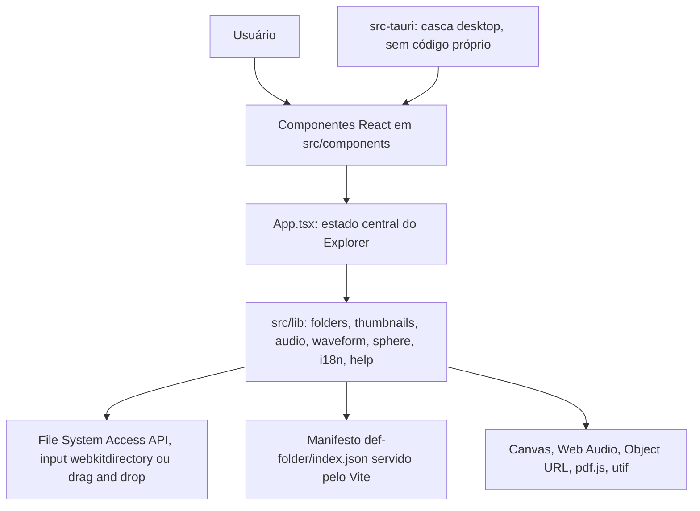

# Orbit Files — Documentação

Documentação do projeto: o que o app faz, como ele é organizado, regras de desenvolvimento, o que fazer e o que não fazer.

- [1. Visão geral](#1-visão-geral)
- [2. Como rodar](#2-como-rodar)
- [3. Stack](#3-stack)
- [4. Arquitetura (system design)](#4-arquitetura-system-design)
- [5. Modelo de dados](#5-modelo-de-dados)
- [6. Funcionalidades e comportamento esperado](#6-funcionalidades-e-comportamento-esperado)
- [7. Estrutura de pastas](#7-estrutura-de-pastas)
- [8. Regras do projeto](#8-regras-do-projeto)
- [9. O que fazer](#9-o-que-fazer)
- [10. O que não fazer](#10-o-que-não-fazer)
- [11. Pontos de atenção e armadilhas conhecidas](#11-pontos-de-atenção-e-armadilhas-conhecidas)
- [12. Limitações conhecidas](#12-limitações-conhecidas)
- [13. Build, distribuição e versão](#13-build-distribuição-e-versão)
- [14. Git e fluxo de contribuição](#14-git-e-fluxo-de-contribuição)
- [15. Glossário](#15-glossário)

---

## 1. Visão geral

**Orbit Files** é um explorador de pastas e arquivos que mostra o conteúdo de uma pasta como pontos em um globo giratório.

- Cada **subpasta** da pasta carregada é um ponto no globo.
- Cada **arquivo que está direto na pasta carregada** (não em subpasta) também é um ponto.
- Arquivos dentro de subpastas não são pontos: são encontrados pela busca ou pela lista da pasta.
- Clicar em uma subpasta lista os arquivos dela num painel abaixo da busca.
- Clicar em um arquivo abre uma janela de pré-visualização.

**Princípio central: os arquivos nunca saem do computador do usuário.** O app lê os arquivos no próprio navegador (ou no WebView do Tauri) e não envia nada para servidor nenhum. Qualquer mudança que faça o app enviar dados de arquivo para fora contraria o produto.

**Dono e licença:** Christian Frank, licença MIT (`LICENSE`).

---

## 2. Como rodar

Pré-requisitos: Node.js (testado com v26) e npm. Para o app desktop, também Rust e as dependências do Tauri para macOS.

```bash
npm install            # instala as dependências
npm run dev            # servidor de desenvolvimento em http://localhost:5173
npm run typecheck      # tsc --noEmit (checagem de tipos, sem gerar arquivos)
npm run build          # typecheck + build de produção em dist/
npm run preview        # serve o dist/ gerado
npm run tauri dev      # app desktop em modo desenvolvimento
npm run tauri build    # gera o app macOS (.app e .dmg)
```

Não há testes automatizados (não existe script de teste, nem Vitest, nem Jest). A verificação atual é `npm run typecheck` / `npm run build` mais teste manual no navegador.

---

## 3. Stack

| Camada | Tecnologia | Versão no `package.json` | Uso |
|---|---|---|---|
| UI | React | ^18.3.1 | Componentes e estado |
| Linguagem | TypeScript (strict) | ^7.0.2 | Tipos em todo o `src/` |
| Build / dev server | Vite | ^8.3.8 | Bundle, dev server e plugin próprio para `def_folder/` |
| Plugin React | @vitejs/plugin-react | ^6.3.0 | JSX / Fast Refresh |
| Animação | motion (Framer Motion) | ^14.14.0 | Modais e transições |
| Busca | cmdk | ^1.1.1 | Lista de resultados da busca (`Command`) |
| Ícones | lucide-react | ^1.76.0 | Todos os ícones da UI |
| PDF | pdfjs-dist | ^6.5.438 | Miniatura da página 1 de PDFs |
| TIFF | utif | ^3.1.0 | Decodificação de TIFF para miniatura |
| Desktop | Tauri 2 (Rust) | `@tauri-apps/cli` ^2.12.6, `src-tauri/` | Empacota o app como app macOS |

Fonte: Inter (Google Fonts), carregada em `index.html`.

---

## 4. Arquitetura (system design)

### 4.1 Visão em camadas



- **`src/components/`** renderiza a interface. Não deve conter regra de leitura de arquivos.
- **`src/lib/`** contém a lógica sem interface: leitura de pastas, miniaturas, áudio, geometria do globo, traduções e textos de ajuda.
- **`src/App.tsx`** é o único lugar que guarda o estado global do explorador (pastas carregadas, seleção, busca, pré-visualização).
- **`src-tauri/`** é só a casca nativa. Não há comandos Rust próprios: o app usa as APIs do navegador dentro do WebView.

### 4.2 Fluxo de carregamento de pastas

1. **Pasta padrão (ao iniciar):** `src/lib/defaultFolder.ts` busca `/def-folder/index.json`. Esse arquivo é gerado pelo plugin `defaultFolder()` do `vite.config.ts` a partir de `def_folder/`.
2. **Pasta escolhida pelo usuário:** o ícone de pasta ao lado da busca (`FolderLoader`) abre:
   - no Chromium (Chrome, Edge): `showDirectoryPicker` via `pickDirectoryFolders()`;
   - em Firefox e Safari: `<input webkitdirectory>` via `foldersFromFileList()`.
3. **Arrastar e soltar:** soltar uma pasta em qualquer lugar da página chama `readDroppedFolders()`.
4. Qualquer carregamento feito pelo usuário **substitui** a pasta padrão. Se a pasta padrão ainda estiver carregando, ela é descartada (`userLoaded` em `App.tsx`).

Todos esses caminhos produzem o mesmo tipo `Loaded` (`{ folders, files }`), e o resto do app não sabe de onde veio.

### 4.3 Leitura preguiçosa (lazy)

- A **lista de arquivos** de cada subpasta só é lida quando a pasta é selecionada (`listFiles()`). Porém, a busca precisa encontrar arquivos em qualquer subpasta, então `App.tsx` faz um índice (`indexed`) lendo a lista de todas as subpastas carregadas.
- O **conteúdo** de um arquivo só é lido quando ele é aberto (`open()`), quando sua miniatura aparece na tela, ou quando o áudio começa a tocar.
- Miniaturas são geradas com `IntersectionObserver` (margem de 120 px), então só as visíveis são decodificadas.

Consequência: nunca leia o conteúdo de todos os arquivos de uma vez. Isso é deliberado para pastas grandes.

### 4.4 Globo

- `src/components/Globe.tsx` desenha tudo num `<canvas>` (não em SVG nem DOM). Redesenho a 24 quadros por segundo.
- `src/lib/sphere.ts` espalha os pontos na esfera com uma espiral de ângulo áureo (`folderPoint`) e faz a projeção (`projectPoint`, `viewFor`).
- Há 2000 pontos de fundo (`AMBIENT`), decorativos, mais tênues que os pontos de pasta.
- A rotação automática dá uma volta a cada 60 segundos. Ela pausa durante o arraste e volta 1,5 s depois de soltar.
- Respeita `prefers-reduced-motion` (sem giro automático e sem inércia).
- A busca gira o globo para o melhor resultado (`match`) e escurece os pontos que não batem com a busca.

### 4.5 Busca

- `rankByLabel()` em `src/lib/folders.ts`: todas as palavras digitadas precisam aparecer no nome (tokens). Pontuação: começa com o texto = 3, contém o texto = 2, só tokens = 1. Empate ordenado por nome com comparador numérico (`Intl.Collator` com `numeric: true`).
- Busca vazia: as 5 primeiras pastas (`FEATURED_FOLDERS`).
- Limite de 40 resultados (`RESULT_LIMIT`).
- Busca só olha nomes, nunca o conteúdo dos arquivos.

### 4.6 Painel de arquivos e pré-visualização

- `FilePanel` lista os arquivos da pasta selecionada. Fecha ao clicar fora (listener de `pointerdown` em fase de captura em `App.tsx`).
- `FilePreview` é um modal em portal (`document.body`). Escolhe o tipo pelo MIME e pela extensão: imagem, PDF (iframe), vídeo, áudio, texto (primeiros 200 KB) ou "sem pré-visualização". Fecha com Escape, botão X ou clique no fundo.
- URLs de objeto (`URL.createObjectURL`) são revogadas quando o modal fecha.

### 4.7 Miniaturas e áudio

- `src/lib/thumbnails.ts`: JPEG de até 320 px no maior lado, qualidade 0,72, fundo `#0b1015`. PSD usa a miniatura embutida (`src/lib/psd.ts`, lê só os primeiros 8 MB). TIFF usa `utif`. PDF renderiza a página 1 com pdf.js. Resto: `createImageBitmap`. Cache por arquivo em `WeakMap`.
- `THUMB_EXTENSIONS` (psd, png, tif, tiff, jpg, jpeg, gif, pdf) define quais arquivos têm miniatura de imagem.
- `src/lib/waveform.ts`: forma de onda com 48 barras, decodificada com Web Audio. Arquivos acima de 100 MB não são decodificados.
- `src/lib/audio.ts`: **um único** `Audio` compartilhado. Tocar outro arquivo para o atual. Componentes assinam o estado com `useSyncExternalStore`.

### 4.8 Idiomas e textos

- `src/lib/i18n.tsx`: 7 idiomas (en, pt, de, es, it, fr, pl). Dicionário `en` é a referência; os outros precisam ter as mesmas chaves (o tipo `Dict` garante isso).
- Idioma escolhido é salvo em `localStorage` (com try/catch).
- Textos do guia de ajuda ficam em `src/lib/help.ts`, também nos 7 idiomas.

### 4.9 Casca Tauri

- `src-tauri/tauri.conf.json`: janela "Orbit Files" de 780×870 (mínimo 360×480), identificador `com.ccnfrank.orbitfiles`, alvos `app` e `dmg`, macOS 11.0 ou superior.
- `security.csp` está `null` (sem Content Security Policy).
- `capabilities/default.json` dá só `core:default` à janela `main`. Não há plugin de sistema de arquivos: o acesso a arquivos é pelo navegador.
- `src-tauri/src/lib.rs` só inicia o Tauri. Não há comandos Rust.

---

## 5. Modelo de dados

Definidos em `src/lib/folders.ts`:

```ts
type FileItem = { name: string; open: () => Promise<File> };   // lê o arquivo só ao ser chamado
type Folder   = { name: string; listFiles: () => Promise<FileItem[]> };
type Loaded   = { folders: Folder[]; files: FileItem[] };      // resultado de qualquer carregamento
type SearchEntry = {                                            // uma linha da busca
  id: string; kind: "folder" | "file"; label: string;
  sublabel?: string; folder?: string; item?: FileItem;
};
```

- `FileItem.name` pode ser um caminho relativo (`"sub/pasta/arquivo.jpg"`) quando o arquivo está dentro da subpasta, em qualquer profundidade.
- Chaves do globo: `folder:<nome>` para subpastas e `file:<nome>` para arquivos da raiz (`App.tsx`).
- Chaves de busca: `folder:<nome>`, `file:<pasta>/<nome>` e `root-file:<nome>`.
- Pastas e arquivos são sempre ordenados com `Intl.Collator` numérico, para que "2" venha antes de "10".

Não há banco de dados, nem persistência além do idioma no `localStorage`. Ao recarregar a página, a pasta carregada pelo usuário se perde (a pasta padrão volta).

---

## 6. Funcionalidades e comportamento esperado

### 6.1 Carregar pasta
- Botão de pasta ao lado da busca, ou arrastar e soltar em qualquer lugar.
- Carregar outra pasta substitui a atual e fecha painel e pré-visualização.
- Pastas vazias: no Chromium aparecem; em Firefox e Safari não aparecem (o navegador só informa pastas que têm arquivos).

### 6.2 Globo
- Gira sozinho; arraste para girar e inclinar (inclinação limitada).
- Clique (sem arrastar) em um ponto seleciona a pasta ou abre o arquivo.
- Passar o mouse mostra o nome do ponto.
- Pontos de pasta emitem pulsos de radar quando estão de frente para o usuário (só visual).

### 6.3 Busca
- Digitar filtra pastas e arquivos de todas as subpastas.
- Escolher um resultado de pasta seleciona a pasta; escolher um arquivo abre o arquivo (e seleciona a pasta dele antes).
- Setas movem entre resultados, Enter escolhe, Escape fecha a lista.

### 6.4 Painel da pasta
- Lista de arquivos com botões Lista e Miniaturas, mostrados só quando a pasta tem imagens ou PDFs.
- Miniaturas: 4 colunas, duas linhas visíveis, com rolagem.
- Áudio aparece com forma de onda e botão de play sem abrir a pré-visualização.

### 6.5 Pré-visualização
- Imagens, PDFs, vídeos, áudios e textos. Texto mostra só os primeiros 200 KB, com aviso.
- Metadados: tamanho, tipo MIME ou extensão, data de modificação.
- Erro de leitura mostra "Este arquivo não pôde ser aberto."

### 6.6 Idioma e ajuda
- Seletor EN / PT / DE / ES / IT / FR / PL no canto superior direito.
- Botão de ajuda (?) abre o guia. Botão de informações no rodapé mostra versão e data de criação.

### 6.7 Teclado
- Tab leva ao campo de busca, ao botão de carregar e ao globo.
- Globo: setas trocam de ponto, Enter ou Espaço selecionam, Escape limpa a seleção.
- Busca: seta para baixo abre os resultados, setas navegam, Enter escolhe, Escape fecha.
- Pré-visualização e diálogos: Escape fecha.

---

## 7. Estrutura de pastas

```
orbitfiles/
├── index.html                  Página HTML, título, fonte Inter, favicon
├── vite.config.ts              Vite + plugin defaultFolder() (manifesto e cópia de def_folder/)
├── package.json                Scripts e dependências
├── tsconfig.json               TypeScript estrito (strict: true)
├── def_folder/                 Pasta padrão carregada ao iniciar (vai junto no build)
├── public/                     Favicon e apple-touch-icon
├── src/
│   ├── main.tsx                Ponto de entrada React (StrictMode)
│   ├── App.tsx                 Estado global do Explorer e layout principal
│   ├── styles.css              Todo o CSS (classes com prefixo learning-*)
│   ├── utif.d.ts               Tipos para a biblioteca utif
│   ├── components/
│   │   ├── Globe.tsx           Globo em canvas, arraste, teclado, pulsos
│   │   ├── FolderSearch.tsx    Campo de busca, resultados, alternância lista/grade
│   │   ├── FolderLoader.tsx    Botão de carregar pasta (picker ou input)
│   │   ├── FilePanel.tsx       Arquivos da pasta selecionada
│   │   ├── FilePreview.tsx     Modal de pré-visualização
│   │   ├── FileThumb.tsx       Um bloco de miniatura (imagem ou forma de onda)
│   │   ├── AudioPlayButton.tsx Botão play/pause de áudio
│   │   ├── AppDialogs.tsx      Botões de ajuda e de informações
│   │   ├── Dialog.tsx          Modal genérico (ajuda, sobre)
│   │   └── LanguageSwitch.tsx  Seletor de idioma
│   └── lib/
│       ├── folders.ts          Leitura de pastas (picker, input, drop), busca ranqueada
│       ├── defaultFolder.ts    Carrega def-folder/index.json
│       ├── thumbnails.ts       Miniaturas de imagem, PDF, TIFF e PSD
│       ├── psd.ts              Extrai a miniatura JPEG de um PSD
│       ├── audio.ts            Player único compartilhado
│       ├── waveform.ts         Picos de onda de áudio
│       ├── sphere.ts           Geometria e projeção do globo
│       ├── i18n.tsx            Dicionários e provedor de idioma
│       ├── help.ts             Conteúdo do guia de ajuda (7 idiomas)
│       └── app-info.ts         Versão e data de criação exibidas no "Sobre"
└── src-tauri/                  Casca desktop (Tauri 2 / macOS)
    ├── tauri.conf.json         Janela, identificador, bundle, macOS 11+
    ├── capabilities/default.json  Permissões da janela principal
    ├── src/lib.rs              Inicialização do Tauri
    ├── src/main.rs             Ponto de entrada do binário
    ├── icons/                  Ícones do app
    └── Cargo.toml              Dependências Rust
```

---

## 8. Regras do projeto

1. **Privacidade:** nenhum arquivo do usuário sai do computador. Não adicione upload, analytics ou chamadas de rede que levem conteúdo ou nomes de arquivo.
2. **Leitura sob demanda:** não leia conteúdo de arquivo antes que o usuário peça (abrir, miniatura visível, play). Listar nomes é permitido; ler bytes não é.
3. **Separação de camadas:** interface em `components/`, lógica em `lib/`. Componente não faz leitura de arquivo direto; ele chama `open()`, `listFiles()` ou funções de `lib/`.
4. **Textos traduzidos:** todo texto visível ao usuário passa por `t("chave")` e existe nos 7 idiomas de `i18n.tsx`. O guia de ajuda muda em `help.ts`, também nos 7 idiomas.
5. **Um só player de áudio:** não crie outro `Audio()`. Use `toggleAudio` de `lib/audio.ts`.
6. **Pasta carregada substitui a anterior:** nenhum carregamento deve mesclar pastas.
7. **Tipos estritos:** o build exige `strict`. `npm run typecheck` precisa passar antes de qualquer commit.
8. **Tema escuro fixo:** o app é escuro (`color-scheme: dark`, fundo `#090c10`). Use as cores de `:root` em `styles.css`.
9. **Nomes de classe:** CSS usa o prefixo `learning-` (herança do projeto original). Mantenha o padrão nas classes novas.
10. **Comentários em inglês**, como no restante do código.
11. **Acessibilidade:** botões com `aria-label` e `title`, `aria-pressed` em alternâncias, respeito a `prefers-reduced-motion`, navegação por teclado.

---

## 9. O que fazer

- **Antes de mexer:** rode `npm run typecheck` e `npm run dev`, e confirme que o app funciona.
- **Para cada texto novo:** adicione a chave em `en` e nos outros seis idiomas de `src/lib/i18n.tsx`.
- **Para cada tipo de arquivo novo:** adicione a extensão nos conjuntos certos:
  - `THUMB_EXTENSIONS` em `thumbnails.ts` se for imagem com miniatura;
  - `AUDIO_EXTENSIONS` em `audio.ts` se for áudio;
  - `kindOf()` em `FilePreview.tsx` se for pré-visualizável;
  - `MIME` em `vite.config.ts` se for servido pela pasta padrão.
- **Ao mudar a leitura de pastas:** teste os três caminhos (picker do Chromium, input em Firefox/Safari e arrastar e soltar).
- **Ao mudar o globo:** teste arraste, clique, teclado e `prefers-reduced-motion`.
- **Ao mudar `def_folder/`:** lembre que o conteúdo vai para o build e para o repositório git. Mantenha arquivos grandes sob controle.
- **Ao mudar a versão:** atualize `version` em `src-tauri/tauri.conf.json` e `src-tauri/Cargo.toml`, e `APP_VERSION` em `src/lib/app-info.ts`.
- **Ao gerar o app macOS:** rode `npm run tauri build` e confira o `.dmg` gerado em `src-tauri/target/`.
- **Ao criar uma branch:** parta da `main` atualizada e use nome curto e descritivo.
- **Antes de abrir PR:** typecheck, build e teste manual com a pasta padrão e com uma pasta externa.

---

## 10. O que não fazer

- **Não envie arquivos ou nomes de arquivo para nenhum servidor**, nem para analytics, nem para API de terceiros.
- **Não leia todos os arquivos de uma vez** (por exemplo, para gerar miniaturas de tudo ao carregar). Pastas grandes ficariam travadas.
- **Não crie um segundo player de áudio** nem use `<audio>` solto fora de `lib/audio.ts` para tocar em grade.
- **Não coloque texto fixo na interface** sem passar pelo `t()`. (Hoje o título "Orbit Files" e o crédito em `App.tsx` estão fixos; não copie esse padrão.)
- **Não adicione dependência nova sem motivo claro.** O projeto é enxuto. Antes, confirme se a funcionalidade já não existe com o navegador ou com as bibliotecas atuais.
- **Não use `innerHTML` nem `dangerouslySetInnerHTML`** com conteúdo vindo de arquivo ou de nome de arquivo. Nomes de arquivo são dados do usuário.
- **Não confie em `file.type` sozinho:** o app compara o MIME com a extensão em `kindOf()`, porque o MIME pode vir vazio.
- **Não remova o `revokeObjectURL` de `FilePreview.tsx` nem de `audio.ts`**, e não tire o cache `WeakMap` de miniaturas e de forma de onda: sem eles a memória cresce em sessões longas com pastas grandes.
- **Não mude `RESULT_LIMIT`, `TEXT_LIMIT`, o limite de 100 MB do áudio ou os 8 MB do PSD sem medir o efeito** em memória e tempo.
- **Não quebre o arraste do globo:** o limiar de 4 px separa clique de arraste. Mudanças aí afetam a seleção.
- **Não remova o `preventDefault` do `onMouseDown`** dos botões de áudio e da barra de ferramentas da busca: sem ele, a lista de resultados fecha ao clicar.
- **Não coloque `def_folder/` dentro de `src/`.** O plugin do Vite lê exatamente `def_folder/` na raiz.
- **Não faça commit direto na `main`** e não force push (`--force`) em branch compartilhada.
- **Não commite arquivos de segredo** (`.env`, credenciais). Hoje o `.gitignore` cobre `node_modules/`, `dist/`, `*.log`, `.DS_Store`, `src-tauri/target/` e `src-tauri/gen/`.
- **Não suponha que vídeo tem miniatura ou forma de onda.** Vídeo só é tocado na pré-visualização.

---

## 11. Pontos de atenção e armadilhas conhecidas

- **DataTransfer expira:** em `readDroppedFolders()`, as entradas do drop são lidas de forma síncrona antes do primeiro `await`. Não mova isso para depois de um `await`, ou os itens somem.
- **`webkitdirectory` não informa pastas vazias** (Firefox e Safari). É limitação do navegador, não bug do app.
- **Caminhos no input de pasta:** em `foldersFromFileList()`, um arquivo na raiz tem caminho `raiz/arquivo` (duas partes). Um arquivo em subpasta tem três ou mais partes. Mudar essa regra quebra a separação entre arquivos da raiz e de subpastas.
- **Dupla leitura da pasta:** `App.tsx` lê todas as subpastas para o índice da busca (ao carregar) e de novo ao selecionar uma pasta. Pastas muito grandes demoram um pouco para a busca achar tudo.
- **Pasta padrão no build:** o `generateBundle` copia `def_folder/` inteira para `dist/def-folder/`. Ou seja, o build (e o app macOS) carrega esses arquivos mesmo offline.
- **Servidor de desenvolvimento:** o middleware serve `def_folder/` ao vivo. Arquivo novo aparece sem reiniciar, mas o manifesto (`index.json`) é gerado a cada requisição; pastas enormes deixam o carregamento lento.
- **Proteção de caminho:** `serveDefaultFolder` recusa caminhos fora de `def_folder/` (checagem com `path.resolve`). Não remova essa checagem.
- **PDF com pdf.js:** o worker é carregado com `?url` do Vite. Se mudar a versão de `pdfjs-dist`, confira o caminho do worker em `thumbnails.ts`.
- **Miniatura PSD:** só lê os primeiros 8 MB. PSDs sem miniatura embutida caem no placeholder com a extensão.
- **Estado do globo e da busca:** `Globe` recebe `query` e `match` de `App.tsx`. Se mudar a busca, confira o escurecimento dos pontos e o giro para o melhor resultado.
- **Limpeza de URL de objeto:** `FilePreview` revoga a URL no cleanup do efeito. Em `audio.ts`, a URL anterior é revogada ao tocar outro arquivo. Já as miniaturas de `thumbnails.ts` criam uma URL por arquivo e **nunca a revogam**: ela fica no cache até o fim da sessão. Se isso virar problema em pastas enormes, a correção é revogar ao descartar do cache.
- **StrictMode:** `main.tsx` usa `StrictMode`, que roda efeitos duas vezes em desenvolvimento. Efeitos que carregam dados precisam de flag `cancelled` (já é o padrão do projeto).

---

## 12. Limitações conhecidas

- Não há busca dentro do conteúdo dos arquivos, só nos nomes.
- Só 2 níveis de pontos no globo: subpastas da pasta carregada e arquivos da raiz. Sub-subpastas não viram pontos (os arquivos delas aparecem na busca e no painel).
- A pasta carregada pelo usuário se perde ao recarregar a página.
- Firefox e Safari não mostram pastas vazias.
- Formatos de áudio e vídeo dependem do que o navegador (ou o WebView do Tauri) decodifica. Ogg, WAV, MP3, AAC e M4A costumam funcionar; o suporte exato depende da plataforma.
- Forma de onda não é gerada para arquivos acima de 100 MB.
- Texto com mais de 200 KB é mostrado truncado.
- Não há testes automatizados.
- Não há ESLint, Prettier nem CI configurados.
- O app desktop só é gerado para macOS (`targets` com `app` e `dmg`).

---

## 13. Build, distribuição e versão

- **Build web:** `npm run build` gera `dist/`. Esse é o `frontendDist` do Tauri.
- **App macOS:** `npm run tauri build`. Requer Rust e as ferramentas do Tauri. Exige macOS 11.0 ou superior.
- **Identificador:** `com.ccnfrank.orbitfiles`.
- **Versão atual:** `0.8.0` no Tauri e no Cargo, `0.8` em `APP_VERSION`. O `package.json` ainda tem `"version": "1.0.0"` e `"name": "learn-anything-clone"` (nomes herdados do projeto original).
- **Data de criação:** `APP_CREATED` em `app-info.ts` (2026-11-19).

---

## 14. Git e fluxo de contribuição

- Branch principal: `main`.
- Commits com mensagem curta no imperativo, em inglês. Exemplos do histórico: "Add Tauri macOS app", "Version the default folder def_folder/".
- Fluxo sugerido:
  1. Atualize a `main`.
  2. Crie uma branch curta (`hide-grid-for-audio-only`, por exemplo).
  3. Faça as mudanças e rode `npm run typecheck` e `npm run build`.
  4. Teste manualmente no navegador (com a pasta padrão e com uma pasta externa) e, se mexer na casca, com `npm run tauri dev`.
  5. Faça commit, envie com `git push -u origin <branch>` e abra o PR contra `main`.
- Remoto: `https://github.com/ccnfrank/orbitfiles`.

---

## 15. Glossário

- **Pasta carregada:** a pasta escolhida pelo usuário (ou a pasta padrão). É a raiz dos pontos do globo.
- **Subpasta:** pasta direta dentro da pasta carregada. Vira um ponto no globo.
- **Arquivo da raiz:** arquivo que está direto na pasta carregada. Vira um ponto no globo.
- **Ponto:** item clicável no globo (subpasta ou arquivo da raiz).
- **Painel de arquivos:** lista de arquivos da subpasta selecionada, abaixo da busca.
- **Pré-visualização:** modal que abre um arquivo.
- **Pasta padrão (`def_folder/`):** pasta do projeto carregada ao iniciar e incluída no build.
- **Miniatura (thumb):** imagem pequena gerada para um arquivo visível (imagem, PDF, PSD, TIFF) ou forma de onda (áudio).
- **Leitura preguiçosa (lazy):** ler o conteúdo de um arquivo apenas quando necessário.
